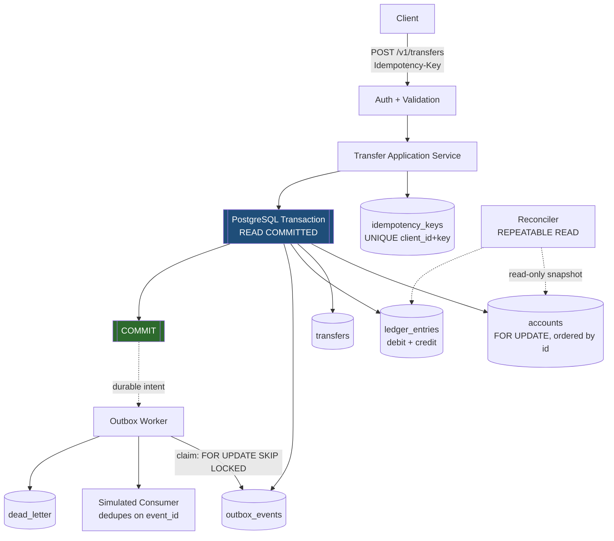

# KIFARU

**Transaction reliability platform — a correctness-first simulation of mobile-money transfer processing, written in Rust.**

> **Status: Phases 0-2 (correctness core + outbox) built and verified against a
> live PostgreSQL.** 87 automated tests pass. Reconciliation, observability
> hardening, and benchmarks remain `[PLANNED]`.
> Every feature claim below is labeled. Nothing here is a claim about measured
> performance, and no benchmark has been run yet.
> See [progress.md](./progress.md) for live build state.

---

## 1. Status legend

Every feature claim in this document carries one of these labels. Nothing is
unlabeled, and nothing is presented as working when it is not.

| Label | Meaning |
|---|---|
| `[IMPLEMENTED]` | Code exists, is committed, and is covered by an automated test that has been run and passed. |
| `[PARTIAL]` | Some of it exists; the gaps are stated inline. |
| `[PLANNED]` | Decided and specified, not yet written. |
| `[UNSUPPORTED]` | Deliberately out of scope. Stated so nobody assumes otherwise. |

---

## 2. Problem being solved

Most transaction-processing demos prove that money moves. Very few prove the
things that actually break in production:

- A client retries after a network timeout and the money moves **twice**.
- Two concurrent transfers race and an account is **overdrawn**.
- The service dies between "database committed" and "response sent" and the
  client's outcome is **unknown forever**.
- A background worker publishes an event, then crashes before recording that it
  did — and the consumer **double-counts**.
- A bug silently corrupts a balance, and nothing notices for months.

KIFARU is built to make each of those failures *reproducible on demand* and to
prove that the financial invariants survive them. The deliverable is not a
feature count — it is a system a skeptical engineer can clone, break, and
independently verify.

**This is a simulation.** It is not connected to any real payment network,
financial institution, or customer account. It is **not** a certified financial
system and makes no PCI DSS or regulatory compliance claim. See
[§15 Security](#15-security-and-threat-model).

---

## 3. Architecture
`[IMPLEMENTED]` - see `crates/` for the implementation
`[PLANNED]`



### Synchronous vs asynchronous

| Step | Mode | What a `200 OK` guarantees |
|---|---|---|
| Validate, authenticate, authorize | Synchronous | Request is well-formed and the caller is permitted. |
| Resolve idempotency key | Synchronous | Either a fresh key or a verified replay of the original committed result. |
| Lock, verify funds, write balances, transfer row, ledger entries, outbox event, **commit** | Synchronous, one DB transaction | All financial effects and the outbox event are **durably committed together**. |
| Outbox event publication | **Asynchronous** | Nothing. The 200 says only that the intent is durably stored. |
| Reconciliation | **Asynchronous** (separate command) | Nothing. It is an independent audit. |

A successful transfer response means: *these two balances moved, these two
ledger entries exist, and an outbox event recording that fact is committed — all
in the same atomic database transaction.* It does **not** mean any downstream
consumer has seen the event.

---

## 4. Technology choices

`[DECIDED]` — chosen deliberately; rationale recorded in `docs/adr/`.

| Choice | Why | Alternative rejected |
|---|---|---|
| **Rust** (stable, pinned) | Ownership model makes the "no partial state" invariant far easier to express and review. | Go — weaker static guarantees around financial invariants. |
| **PostgreSQL as source of truth** | Real row locking, real isolation levels, real `SKIP LOCKED`. Proving concurrency guarantees requires the real engine. | SQLite — **explicitly rejected for anything testing locking or isolation.** |
| **`i64` minor units** (`BIGINT`) | Exact by construction. Zero rounding-mode ambiguity. Maps 1:1 to SQLx. | `rust_decimal` — 96-bit, slower, and buys multi-currency generality this MVP doesn't need. Trade-off: a second currency with a different scale requires a scale-aware `Money` type. |
| **`READ COMMITTED` + ordered `FOR UPDATE`** | Invariants carried by locks and constraints, not by a heavier isolation level. Locking accounts in ascending ID order eliminates the A→B / B→A deadlock without retry storms. | `SERIALIZABLE` — retry storms under contention for guarantees we don't need once both rows are locked. |
| **Axum** | Tokio-native, tower middleware composes cleanly for auth/rate-limit/trace layers. | Actix — historically a separate async runtime. |
| **SQLx** | Compile-time query verification; no hidden runtime SQL. | Diesel — less ergonomic async story. |
| **Single binary, 3 subcommands** | One build, one lockfile, trivially reproducible local runs. | Multi-crate split now — adds build ceremony before any invariant is proven. |

Deliberately **not** in the MVP `[UNSUPPORTED]`: Kafka, Kubernetes, service mesh,
custom consensus. A real broker is a later milestone, never a prerequisite for
proving the core guarantees.

---

## 5. Repository layout

`[PLANNED]` — five crates, not eight. Worker and observability are modules
inside `kifaru-api` until there's a genuine service boundary.

```
kifaru/
├── Cargo.toml                  workspace
├── rust-toolchain.toml         pinned
├── README.md  progress.md
├── .env.example                placeholders only
├── docker-compose.yml          postgres + deps
├── migrations/                 sqlx migrations
├── crates/
│   ├── kifaru-domain/          money, currency, accounts, transfers, ledger, state machines
│   ├── kifaru-application/     transfer service, idempotency, reconciliation + port traits
│   ├── kifaru-storage/         sqlx impls, error classification
│   ├── kifaru-api/             axum routes, auth middleware, worker, observability, `main.rs`
│   └── kifaru-testkit/         fixtures, seed data, invariant assertions
├── tests/
│   ├── integration/  concurrency/  recovery/  invariants/
├── benchmarks/  chaos/
├── docs/
│   ├── invariants.md           INV-1..INV-7, authoritative
│   ├── architecture/  adr/
│   ├── threat-model.md  failure-matrix.md
│   └── benchmark-methodology.md  operations.md
└── .agents/skills/             project-scoped agent skills
```

Dependency direction is strict: `api` → `application` → `domain`.
`application` defines ports; `storage` implements them. Domain logic compiles
and tests with **no database and no HTTP server**, so business rules are testable
in isolation.

---

## 6. Quick start

> **Not yet runnable.** Phase 0 has not produced a buildable system.
> This section is written to the shape the final instructions will take.

**Prerequisites** `[IMPLEMENTED]`
- Rust pinned via `rust-toolchain.toml` (verified: 1.99.0)
- Docker Desktop with the Linux engine running (verified: PostgreSQL 17, host port 5434)

**Commands**

```sh
docker compose up -d                # dependencies (postgres:17, pinned)
cp .env.example .env                # then edit DATABASE_URL
cargo run -- migrate                # apply migrations (idempotent)
cargo run -- serve                  # HTTP API on KIFARU_BIND
cargo run -- worker                 # drain the transactional outbox
cargo run -- outbox-status          # event counts by state
cargo nextest run --workspace       # full suite
cargo run -- reconcile              # [PLANNED] invariant check, non-zero exit
cargo run -- chaos --scenario all   # [PLANNED] documented failure suite
```

`serve` and `worker` are separate processes. Running `worker` is what publishes
committed transfers; `serve` alone leaves events pending, which is correct and
observable via `outbox-status`.

**Known gap:** the API has no money-*in* operation. Accounts open at zero and
money only moves via a transfer, so a transfer cannot be demonstrated over HTTP
without seeding a balance directly in the database. The integration tests do this
via `Harness::seed_opening_balance`, documented as test-only. A real deposit path
is `[PLANNED]`.

Nothing here requires a paid service.

---

## 7. Money and currency

`[PLANNED]`

All monetary values are **`i64` minor units** (e.g. cents) stored as `BIGINT`.

- Floating-point is **never** used for money, anywhere.
- One configured currency with a documented minor-unit scale. The specific
  currency and scale are **still to be pinned** — see [progress.md](./progress.md).
- Amounts must be strictly positive.
- Rounding does not occur in the transfer path because there is nothing to
  round: both ledger legs carry the identical `i64` value.
- Unsupported scales and malformed amounts are rejected at validation, before
  any lock is taken.

---

## 8. Idempotency

`[PLANNED]`

A client submits a transfer with an `Idempotency-Key` header, scoped to the
authenticated client.

| Situation | Behavior |
|---|---|
| First request, new key | Processed normally. Key, request hash, and committed response stored. |
| Retry, identical payload | **Original response replayed.** No second balance movement, no duplicate ledger entries. Idempotency hit counted. |
| Same key, **different** payload | `409 Conflict`. Never silently executes the new body. |
| Concurrent identical requests | Serialized by the `UNIQUE (client_id, key)` index. The loser blocks, then replays the winner's result. |
| Original commit succeeded but client never saw the response | Retry replays from the stored response. The uncertain-outcome case is resolved by identity, not by guessing. |

Uniqueness lives in the **database**, not in application code — application-level
checks cannot survive concurrent requests.

**Retention:** idempotency records outlive the maximum client retry window and
are never pruned while a retry could still land. Policy to be documented with
concrete durations.

---

## 9. Ledger correctness guarantees

`[PLANNED]` — the canonical definitions live in [`docs/invariants.md`](./docs/invariants.md)
and are referenced by every relevant test.

- **INV-1** No account balance is negative under the default overdraft policy.
- **INV-2** Every completed transfer has exactly two ledger entries — same
  `transfer_id`, same currency, equal magnitude, opposite direction.
- **INV-3** Every ledger transaction balances: sum(debits) == sum(credits).
- **INV-4** Stored account balance equals the balance derived from ledger entries.
- **INV-5** No transfer is ever completed without its ledger entries and both
  account updates committed in the same transaction.
- **INV-6** Duplicate idempotent requests never produce duplicate ledger entries
  or a second balance movement.
- **INV-7** Committed ledger entries are immutable. Corrections are made with
  **compensating entries**, never by rewriting history.

The ledger is the accounting record. Stored balances exist for read efficiency
and are updated in the *same* transaction as the entries they correspond to;
reconciliation exists precisely to prove the two agree.

---

## 10. Database transaction boundaries

`[PLANNED]`

One transfer is one PostgreSQL transaction. It either commits whole or not at all:

```sql
BEGIN;                                        -- READ COMMITTED
  -- lock both accounts in ascending account_id order
  SELECT id, balance FROM accounts
   WHERE id IN (:src, :dst) ORDER BY id FOR UPDATE;
  -- verify: both exist, both active, same currency, src.balance >= :amount
  UPDATE accounts SET balance = balance - :amount WHERE id = :src;
  UPDATE accounts SET balance = balance + :amount WHERE id = :dst;
  INSERT INTO transfers        (...) VALUES (...);
  INSERT INTO ledger_entries   (...) VALUES (...), (...);  -- debit + credit
  INSERT INTO outbox_events    (...) VALUES (...);
COMMIT;
```

Any failure before `COMMIT` rolls back completely. A partial financial change is
not representable in a committed state.

**Retry policy:** only on SQLSTATE `40001` (serialization failure) and `40P01`
(deadlock). Maximum 3 attempts, jittered backoff, retrying the **entire**
transaction. An operation with an uncertain commit outcome is never blindly
retried — its idempotency identity is resolved first.

---

## 11. Outbox delivery semantics

`[IMPLEMENTED]`

The outbox event is committed in the same transaction as the transfer. A worker
claims events with `SELECT ... FOR UPDATE SKIP LOCKED` plus a lease
(`locked_until`, `locked_by`), so multiple workers are safe and a crashed
worker's work is reclaimed when its lease expires.

**The actual guarantee — stated precisely:**

> **Durable publication intent, at-least-once delivery attempts under the
> documented operating assumptions, and idempotent consumer processing.**

KIFARU does **not** claim exactly-once delivery, and this README will not be
edited to imply otherwise. Consumers must dedupe on `event_id`; `DedupeConsumer`
does exactly that, and the tests assert that a redelivered event produces
exactly one side effect.

Claiming and leasing happen in a **single statement**, so there is no window in
which an event is selected but not leased, and therefore no window in which two
workers could both believe they own the same event.

Failure handling is per event, so a poison event cannot abort its batch and
strand the healthy events behind it. Each failure records why it failed against
the event itself, releases the lease, and reschedules with exponential backoff.
After `max_attempts` the event is dead-lettered, and the database refuses to let a
dead event exist without the error that killed it.

---

## 12. Reconciliation

`[PLANNED]`

Recomputes expected balances from the ledger inside a `REPEATABLE READ`
read-only transaction, so in-flight transfers cannot produce false positives. It
detects balance drift, transfers missing entries, unbalanced ledger
transactions, invalid transfer↔ledger relationships, and currency mismatches.

Output is a machine-readable JSON report. **Exit code is non-zero when a
critical invariant fails**, so it works as a CI gate.

Reconciliation **never** modifies financial records to conceal a discrepancy.
Remediation is explicit, separately authorized, and audited.

---

## 13. Observability

`[PLANNED]`

Structured JSON logs, request/trace correlation IDs, Prometheus metrics, and
OpenTelemetry tracing. Metrics cover transfer success/failure, idempotency hits
and conflicts, DB transaction failures, deadlock/serialization retries, outbox
backlog and event age, reconciliation discrepancies, and latency histograms.

High-cardinality labels (account IDs, transfer IDs) are **never** used as
Prometheus dimensions. Credentials and sensitive account data never appear in
logs, traces, or metrics.

SLIs and example SLOs will be published as **project targets, not achieved
results**, until measurements exist.

---

## 14. Testing and evidence

`[PLANNED]`

| Layer | Proves |
|---|---|
| Unit | Money arithmetic, validation, state transitions, ledger invariants, error classification. |
| Property-based | Invariants hold across generated amounts, accounts, and operation orderings. |
| Integration | Real Postgres: constraints, rollback, locking, isolation, restart persistence. |
| Concurrency | Conflicting transfers, simultaneous retries, insufficient-funds races, deadlock-prone patterns. |
| Fault injection | Interrupted requests, worker restarts, uncertain commits, duplicate delivery, recovery. |
| API | Validation, authorization, status codes, error shape, pagination, limits. |
| Regression | Every discovered correctness bug produces a regression test. |

Fault scenarios assert **resulting database state and financial invariants** —
not merely that the process restarted. Deterministic injection runs in CI;
randomized chaos runs separately with recorded seeds.

See [`docs/failure-matrix.md`](./docs/failure-matrix.md) for the scenario →
expected outcome → recovery → test mapping. **Not yet written.**

---

## 15. Security and threat model

`[PLANNED]` — full threat model in [`docs/threat-model.md`](./docs/threat-model.md).

Planned coverage: authentication and authorization boundaries, least-privilege
database access, input validation, parameterized queries only, secrets via
environment configuration, no hardcoded credentials, no sensitive transaction
detail in logs, correlation IDs, audit records for privileged operations,
dependency auditing in CI, and explicitly restricted admin endpoints.

**Known posture:** KIFARU is an unauthenticated-by-default development
simulation at this stage. Possession of an account ID will **not** be treated as
authorization to access it. Local development uses a documented identity
mechanism; deployments require a real token-verification strategy.

> **No compliance claim.** KIFARU is not PCI DSS compliant and has not been
> assessed against any regulatory standard. It must not be represented as a
> certified financial system.

---

## 16. Known limitations

Honest list, updated as the build proceeds:

1. **Nothing is implemented.** Phase 0 has produced design decisions and agent
   skills only.
2. Single configured currency, `i64` minor units — a second currency with a
   different minor-unit scale needs a scale-aware `Money` type.
3. No broker integration. The outbox is real; publication targets an in-process
   simulated consumer.
4. `[UNSUPPORTED]` Broker-agnostic exactly-once delivery — not claimed, not
   attempted.
5. ~~Rust toolchain and a running Docker daemon are **still required and not yet
   present** on the development machine.~~ **Resolved**: Rust 1.99.0 and Docker are
   both installed and verified. See [§6](#6-quick-start).

---

## 17. Roadmap

`[PLANNED]`

| Phase | Contents | Gate |
|---|---|---|
| **0** ✅ | Environment inspection, architecture decisions, agent skills, `README.md`, `progress.md` | This document exists and is accurate. |
| **1** | Domain types, schema + migrations, atomic transfer, double-entry ledger, idempotency, unit + integration tests, minimal API | **INV-1..INV-7 passing** against real Postgres. |
| **2** | Outbox, worker, retry/recovery, reconciliation, concurrency tests, deterministic fault injection | Every failure scenario asserts resulting DB state. |
| **3** | Logs, metrics, tracing, health checks, security controls, CI, reproducible local setup | Clean-checkout run works. |
| **4** | Load tests, before/after optimization, failure matrix, ADRs, walkthrough | Real measured numbers, reproducible. |
| **5** | Full suite, defect fixes, clean-environment quick-start validation, documentation audit | Every claim verified. |

**Definition of done** is the spec's §20 checklist, not "it compiles." Each phase
is gated on its own evidence; no phase starts until the prior gate passes.

---

## 18. Documentation honesty policy

Every feature claim in this repository carries a status label. Benchmark numbers
are published only after being measured, with methodology. Test results are
reported from actual runs — if a check was skipped or failed, it is documented
as such. A passing build is not completion.

> The purpose of this project is to be **independently verifiable**. A
> documentation claim that outruns the evidence destroys the only thing the
> project actually delivers.

---

## License

`[PLANNED]` — to be chosen (MIT or Apache-2.0) before the first release.

## Acknowledgements

Project skills in [`.agents/skills/`](./.agents/skills) are installed from
[skills.sh](https://skills.sh); provenance is pinned in `skills-lock.json`.
